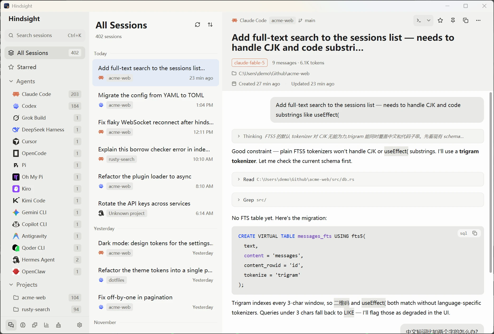
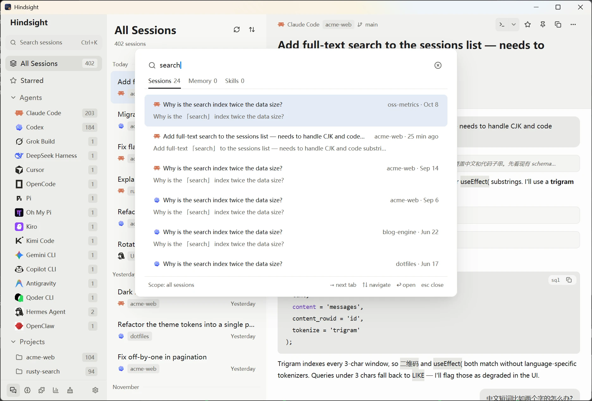

# Hindsight

[](LICENSE)
[](https://github.com/liberty0722/Hindsight/releases/latest)
[](https://github.com/liberty0722/Hindsight/releases/latest)
[](https://github.com/liberty0722/Hindsight/releases)
[](https://github.com/liberty0722/Hindsight/stargazers)
[](https://github.com/liberty0722/Hindsight/actions/workflows/ci.yml)

A native desktop app that gathers every coding-agent session on your machine into one place — find any conversation in seconds, read it in full, and pick it back up in your terminal. Built with Rust + GPUI. Runs on Windows 10/11 (x86_64 and ARM64), with macOS and Linux builds too; the instructions below are written for Windows, with macOS/Linux notes where they differ.

Your agent history is scattered across `%USERPROFILE%\.claude`, `%USERPROFILE%\.codex` and many other folders. Hindsight reads all of it, read-only and entirely on your machine.

**Project: [github.com/liberty0722/Hindsight](https://github.com/liberty0722/Hindsight)** — downloads, the MCP and CLI docs in [docs/](docs/), and the [changelog](CHANGELOG.md).



## Features

- **One place for every session** — grouped by agent and project, sub-agents under their parent, updated live as your agents write
- **Full-text search** (Ctrl+K) — every title and transcript, CJK and code (`useEffect(`) included; jumps straight to the match. Memory files and skills have their own tabs; press Tab to switch
- **Transcript view** — chat bubbles, inline images, collapsible tool calls, thinking, syntax highlighting
- **One-click resume** — back in your terminal (Windows Terminal, PowerShell, Windows PowerShell, Command Prompt, WezTerm, Alacritty) or in Claude / Codex Desktop, in the right project folder
- **Manage** — star, pin, export to Markdown, hand a session to another agent, delete to the Recycle Bin
- **Clean up** — find the sessions eating your disk and clear them out in one go
- **Memory** — the notes and instruction files your agents keep (`CLAUDE.md`, `AGENTS.md`, auto-memory, Cursor rules, …), by agent and project
- **Skills** — every skill your agents have installed, which agents share each one, and which copies have drifted apart
- **Insights** — activity heatmap, streaks, weekly trends, and your top agents, projects and models
- **Remote hosts** — mirror the sessions on your other machines over SSH
- **MCP and CLI** — `hindsight-mcp.exe` and `hindsight-cli.exe` let any agent search your history and read transcripts



## Supported agents

`~` below means your user profile folder (`%USERPROFILE%`, e.g. `C:\Users\you`).

| Agent | Data source | Model | Via |
|---|---|---|---|
| Claude Code | `~/.claude/projects/**/*.jsonl` | ✅ | — |
| Codex CLI | `~/.codex/sessions/**/*.jsonl[.zst]` + `state_5.sqlite` | ✅ | ✅ |
| Qoder CLI | `~/.qoder/projects/*/*.jsonl` | ✅ | — |
| Copilot CLI | `~/.copilot/session-store.db` | — | — |
| Cursor | `~/.cursor/projects/**/agent-transcripts` + Cursor's `state.vscdb` (IDE chats) | ✅ | — |
| OpenCode | `~/.local/share/opencode/opencode.db` | ✅ | — |
| OpenCode 2 (`opencode2`) | `~/.local/share/opencode/{opencode.db,opencode-next.db}` | ✅ | — |
| Kiro | `~/.kiro/sessions/cli` | ✅ | — |
| Gemini CLI | `~/.gemini/tmp/**/chats` | — | — |
| Pi | `~/.pi/agent/sessions/**/*.jsonl` | ✅ | — |
| Oh My Pi | `~/.omp/agent/sessions/**/*.jsonl` | ✅ | — |
| Grok Build | `~/.grok/sessions/**/updates.jsonl` | ✅ | — |
| Kimi Code | `~/.kimi-code/sessions/**/wire.jsonl` | — | — |
| Antigravity | `~/.gemini/antigravity/brain`, `~/.gemini/antigravity-ide/brain`, `~/.gemini/antigravity-cli/brain` + `~/.gemini/antigravity-cli/conversation_summaries.db` | ✅ | ✅ |
| DeepSeek Harness (`dsh`) | `~/.dsh/sessions/**/session*.jsonl[.zstd]` | ✅ | — |
| Hermes Agent | `~/.hermes/state.db` + `profiles/*/state.db` | ✅ | ✅ |
| OpenClaw | `~/.openclaw/agents/*/agent/openclaw-agent.sqlite` + `agents/*/sessions/*.jsonl` | ✅ | ✅ |
| CodeBuddy | `~/.codebuddy/projects/*/*.jsonl` | ✅ | — |
| WorkBuddy | `~/.workbuddy/projects/*/*.jsonl` | ✅ | — |
| ZCode | `~/.zcode/cli/db/db.sqlite` | ✅ | — |
| Craft Agents | `~/.craft-agent/workspaces/*/sessions/*/session.jsonl` | ✅ | ✅ |
| Devin | `~/.local/share/devin/cli/sessions.db` | ✅ | — |
| Kilo Code | `~/.local/share/kilo/kilo.db` + the legacy extension's `globalStorage/kilocode.kilo-code/tasks` | ✅ | ✅ |
| Grok Bot | the desktop app's cache (`Grok Bot/sand-client-persistence`) | — | — |
| MiMo Code | `~/.local/share/mimocode/mimocode.db` | ✅ | — |
| With | the desktop app's cache (`com.tencent.with/data.db` + `qa_detail.db`) | ✅ | — |

Agents' own environment variables (`CODEX_HOME`, `XDG_DATA_HOME`, …) are respected, and Settings → Session locations adds folders anywhere else.

**Model**: Hindsight shows the LLM a session used. **Via**: Hindsight shows where it started (CLI, IDE, desktop app, chat channel). "—" means the agent doesn't record it.

- **Codex** — background threads (auto-review, `/review`, compaction) are skipped; `spawn_agent` sub-agents are listed under their parent
- **Cursor** — chats are read from transcripts, or from Cursor's own database when there is no transcript
- **Craft Agents** — on a Claude connection, Hindsight shows the Craft session and hides the duplicate Claude Code copy
- **Kilo Code** — the new extension, CLI and JetBrains plugin share `kilo.db`; tasks from the legacy extension are listed too
- **Grok Bot** — conversations live in Grok Bot's cloud; Hindsight reads the latest messages the desktop app keeps on this computer, a conversation it no longer keeps stays listed with its last message, and deleting one in Hindsight only hides it
- **MiMo Code** — a session imported from Claude Code, Codex or OpenCode is listed once you continue it in MiMo Code, without the imported part

Not supported: Windsurf and Trae (encrypted), Amp, Factory and Warp (cloud only).

## Remote hosts

Add a machine in Settings → Remote hosts (an `%USERPROFILE%\.ssh\config` alias or `user@host`) and its sessions show up next to yours with an `@host` badge, searchable and resumable through a copied `ssh -t` command. Hindsight syncs on launch, on refresh and on Sync now.

- SSH has to work without prompts: your key loaded in an agent, the host key already trusted
- `rsync` is needed on both ends; on Windows, take `rsync` and `ssh` from the same Cygwin/cwRsync install and put it ahead of Windows OpenSSH in `PATH` ([why](https://cygwin.com/pipermail/cygwin/2022-March/251153.html))
- Only session data is copied, never credentials, and nothing on the remote is ever written
- Remotes are assumed to use default paths; Windows remotes aren't supported (a Windows machine can mirror a macOS/Linux remote, not the other way round)

## Connect your agents

### MCP server

`hindsight-mcp.exe` sits next to `Hindsight.exe` and gives any MCP client five read-only tools:

| Tool | What it does |
|---|---|
| `hindsight_search` | Search every session and memory file |
| `hindsight_list_sessions` | Recent sessions, by project, agent, time or starred |
| `hindsight_get_session` | Read a transcript or memory file, page by page |
| `hindsight_list_projects` | Projects with sessions, most recent first |
| `hindsight_list_memories` | Your agents' memory and instruction files, by project |

Settings → Connect copies the setup with your real install path filled in. By hand (PowerShell; assuming you unzipped to `C:\Tools\Hindsight`):

```powershell
claude mcp add --scope user hindsight -- "C:\Tools\Hindsight\hindsight-mcp.exe"
```

```toml
# %USERPROFILE%\.codex\config.toml
[mcp_servers.hindsight]
command = 'C:\Tools\Hindsight\hindsight-mcp.exe'
```

Full reference: [docs/mcp.md](docs/mcp.md).

### From a shell

`hindsight-cli.exe` gives the same answers in a terminal. Add the Hindsight folder to your user `PATH` once:

```powershell
[Environment]::SetEnvironmentVariable("Path", [Environment]::GetEnvironmentVariable("Path", "User") + ";C:\Tools\Hindsight", "User")
```

Then, in a new PowerShell window:

```powershell
hindsight-cli sessions --project "$PWD" --limit 5      # what happened in this repo
hindsight-cli search "rate limiter" --project "$PWD"   # where was this discussed
hindsight-cli show 'claude-code:1b2c3d4e-…'            # read that transcript
hindsight-cli context                                  # what a new session here starts with
hindsight-cli refresh                                  # update the index while Hindsight is closed
```

`npx skills add liberty0722/Hindsight` teaches agents to reach for it. Full reference: [docs/cli.md](docs/cli.md).

### Claude Code and Codex plugins (macOS and Linux)

On macOS and Linux, a plugin makes every new session start knowing where your agents left off in this project. Its session-start hook is a shell script, so it isn't offered on Windows (Settings → Connect hides it there); on Windows, register the MCP server above, and optionally the [skill](skills/hindsight/SKILL.md).

```bash
claude plugin marketplace add liberty0722/Hindsight --sparse .claude-plugin plugins/hindsight && claude plugin install hindsight@hindsight
```

```bash
codex plugin marketplace add liberty0722/Hindsight --sparse .agents/plugins --sparse plugins/hindsight && codex plugin add hindsight@hindsight
```

Needs Hindsight 0.1.0 or later, opened at least once. In Codex, trust the hook in `/hooks`. More in [docs/cli.md](docs/cli.md#claude-code-plugin).

## Zoom

Make everything bigger — 110%, 125% or 150% — with Ctrl + / Ctrl − / Ctrl 0, or Settings → Appearance. (⌘ instead of Ctrl on macOS.)

## Language

Hindsight follows your Windows display language, with Simplified Chinese built in (Settings → General → Language). A new language is one JSON file, and partial translations are welcome: see [crates/hindsight/locales/README.md](crates/hindsight/locales/README.md).

## Privacy stance

- Agent data is opened read-only; Hindsight never writes to another tool's files
- Credential files (`auth.json` and friends) are never read
- No background network requests: just a manual update check, plus SSH/rsync to remote hosts you add
- Hindsight's index lives in `%LOCALAPPDATA%\hindsight` (`~/Library/Application Support/hindsight` on macOS, `~/.local/share/hindsight` on Linux) and can be rebuilt any time; stars and pins survive. Preferences (language, appearance, zoom, window size) are small files in `%APPDATA%\hindsight`

## Performance

On the author's machine (~1,100 sessions, ~1.8 GB): a full index in ~5 s, searches in a few milliseconds.

## Install

### Windows

Download `hindsight-<version>-windows-x86_64.zip` (an `-arm64.zip` when the release has one) from the [latest release](https://github.com/liberty0722/Hindsight/releases/latest) and unzip it anywhere, e.g. `C:\Tools\Hindsight`. Keep the three files together:

| File | What it is |
|---|---|
| `Hindsight.exe` | the app |
| `hindsight-mcp.exe` | the MCP server (Settings → Connect looks for it next to the app) |
| `hindsight-cli.exe` | the command-line client |

Run `Hindsight.exe`. The binaries aren't code-signed, so SmartScreen may stop the first launch: click *More info* → *Run anyway*. If the zip came from a browser, you can also clear the download mark up front with `Get-ChildItem C:\Tools\Hindsight | Unblock-File`. To pin it, right-click `Hindsight.exe` → *Pin to Start* / *Show more options* → *Pin to taskbar*.

Or build it with the MSVC Rust toolchain (Visual Studio Build Tools with the "Desktop development with C++" workload):

```powershell
git clone https://github.com/liberty0722/Hindsight; cd Hindsight
powershell -ExecutionPolicy Bypass -File scripts\make-windows.ps1   # dist\hindsight-<version>-windows-<arch>.zip
```

### macOS

Download `Hindsight-<version>-macos.zip`, unzip, and drag Hindsight to Applications (a Universal Binary for Apple Silicon and Intel). It's ad-hoc signed, so open it the first time with right-click → *Open*, or run `xattr -d com.apple.quarantine Hindsight.app`. To build: `scripts/make-app.sh` (→ `dist/Hindsight.app`).

### Linux (experimental)

Each release has a `.deb` and a tar.gz (with a no-root `install.sh`) for arm64 and x86_64. To build:

```bash
sudo apt-get install -y libasound2-dev libfontconfig1-dev libwayland-dev \
  libxkbcommon-dev libxkbcommon-x11-dev libssl-dev libzstd-dev pkg-config cmake clang
git clone https://github.com/liberty0722/Hindsight && cd Hindsight
scripts/make-linux.sh        # dist/hindsight-<version>-linux-<arch>.tar.gz and .deb
```

## Development

PowerShell (in Git Bash, the `scripts/*.sh` helpers and `VAR=value cmd` forms also work):

```powershell
cargo run -p hindsight                           # run in dev mode
cargo test -p hindsight-core                     # data-layer tests (adapter contracts, FTS, scanner)
cargo build -p hindsight                         # UI compile gate
cargo run -p hindsight-core --bin scan           # data-layer smoke test: scan and print stats (quit Hindsight first, or add --tmp: it will not write an index Hindsight holds)
cargo run -p hindsight-core --bin scan -- --search "useEffect("   # search smoke test
cargo run -p hindsight-core --bin hindsight-mcp -- setup          # print MCP setup snippets for the dev build
cargo run -p hindsight-core --bin hindsight-mcp -- call hindsight_search '{"query":"useEffect("}'   # run one MCP tool (PowerShell 7.3+; on Windows PowerShell 5.1 write each " as \")
cargo run -p hindsight-core --bin hindsight-cli -- sessions --project "$PWD"   # the CLI against your index
$env:HINDSIGHT_THEME = "dark"; cargo run -p hindsight         # force dark/light (defaults to system); Remove-Item Env:HINDSIGHT_THEME to undo
$env:HINDSIGHT_HOME = "D:\demo-home"; cargo run -p hindsight  # point all agent adapters at a different home dir (portable installs, testing)
$env:HINDSIGHT_LIVE_REMOTE_HOST = "<host>"; cargo test -p hindsight-core --test remote_sync live -- --ignored   # run the remote-host pipeline against a real SSH host
git config core.hooksPath scripts/hooks          # optional: run tests before every commit (needs Git Bash)
python scripts\demo-home.py                      # build a synthetic fake-home dataset for screenshots/demos (see its docstring)
```

`scripts/test.sh` (bash) bundles the test and compile gate into one command; `scripts/test.sh --smoke` adds a real-data scan baseline that reads your local agent folders, read-only.

CI checks formatting, runs the tests and builds the app on Windows, macOS and Linux. Tests use synthetic fixtures only; your real agent data is never touched.

## Architecture

```
crates/
├── hindsight-core        # pure data layer, no UI dependencies
│   ├── adapters/    #   one adapter per storage format (AgentAdapter trait — add an adapter, get the whole UI for free;
│   │                #   remote.rs wraps any adapter over a synced cache for remote hosts)
│   ├── remote.rs    #   remote hosts: ssh probe + rsync whitelist mirror into <data dir>/remotes/<host>/
│   ├── scanner.rs   #   single-pass scan: meta + FTS in one go, mtime incremental
│   ├── watcher.rs   #   notify-based file watching → per-file incremental updates
│   ├── skills.rs    #   read-only skills overview: each agent's skill folders, grouped by skill
│   ├── db.rs        #   rusqlite (WAL): sessions, the full-text index, memories, stars/pins, tombstones, settings
│   ├── mcp/         #   hindsight-mcp: read-only MCP server over stdio (hand-written JSON-RPC, five tools)
│   ├── cli.rs       #   hindsight-cli: argv → the same five tools, same text out as MCP
│   └── services/    #   terminal resume (per-platform: Win32 / AppleScript / argv) / export / Recycle Bin / agent context helpers
└── hindsight             # GPUI app (three-pane workbench + Ctrl+K palette)
plugins/hindsight         # the Claude Code and Codex plugin (macOS/Linux): session-start hook + MCP, no binaries of its own
skills/hindsight          # the Hindsight skill, for agents that read skills
web/                 # project website (Astro), built from docs/ and CHANGELOG.md
```

Design notes live in [DESIGN.md](DESIGN.md), product decisions in [PRODUCT.md](PRODUCT.md), release history in [CHANGELOG.md](CHANGELOG.md).

## License

[MIT](LICENSE) © 2026 liberty0722. Third-party notices: [THIRD_PARTY_NOTICES.md](THIRD_PARTY_NOTICES.md).
